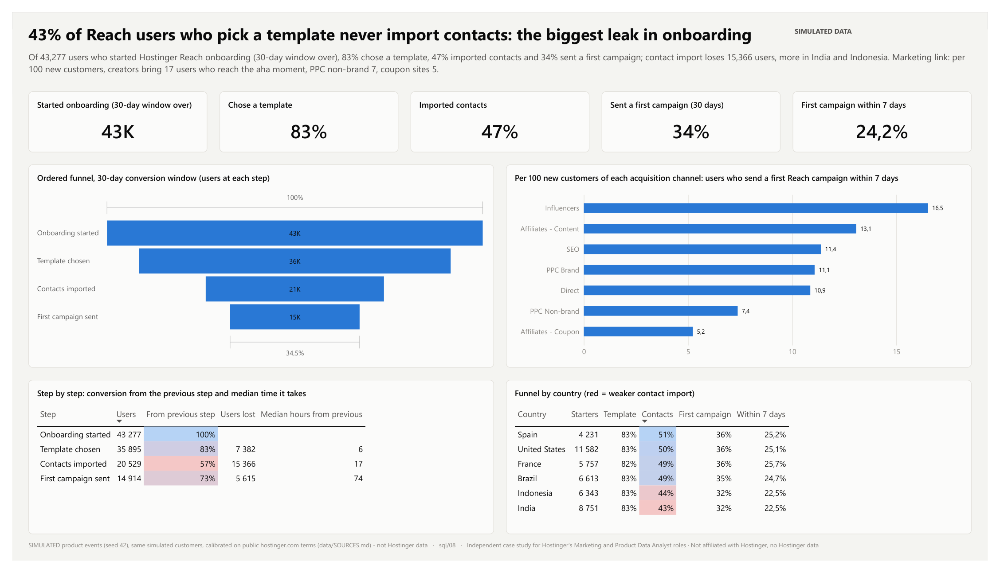
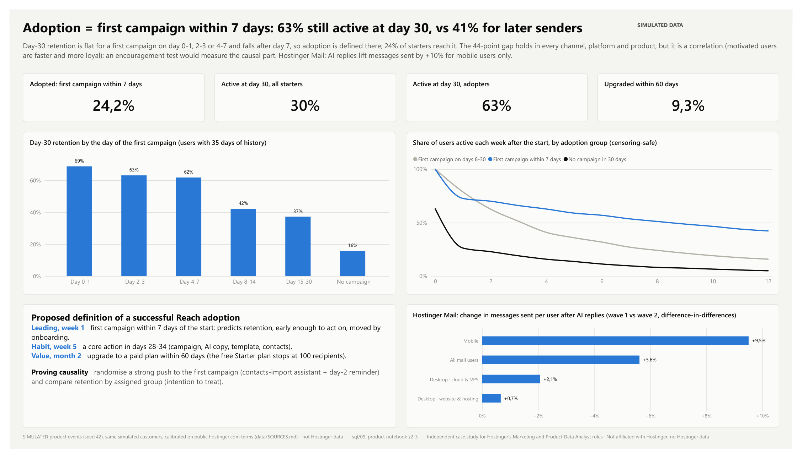
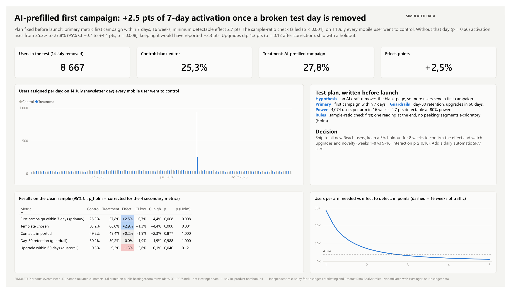
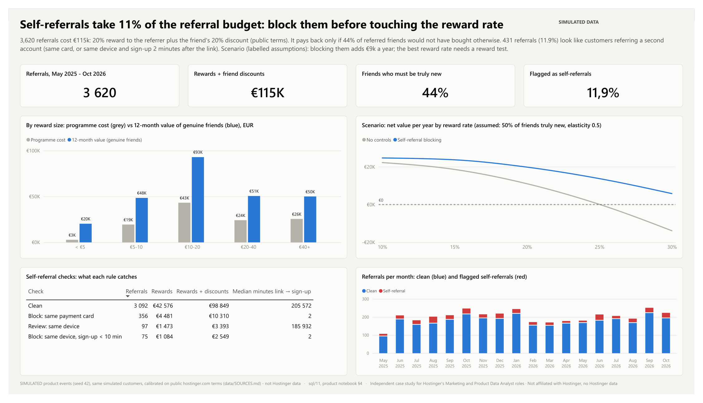
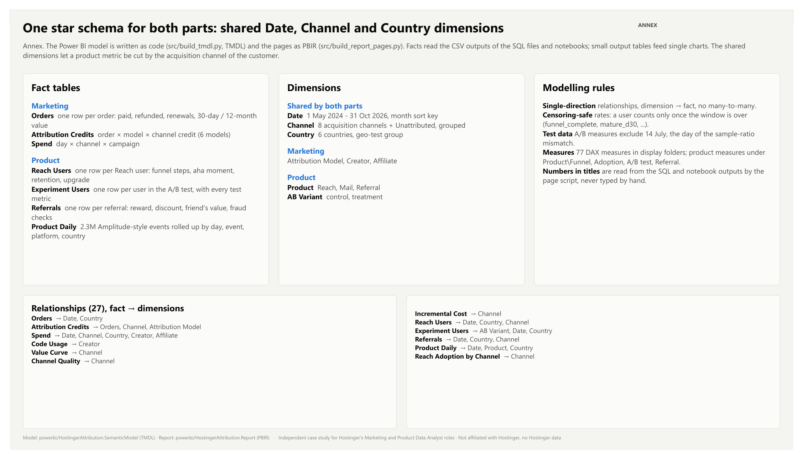

# Hostinger marketing & product analytics: which customers pay back, and do they adopt the products?

Independent case study for **Hostinger's Marketing Data Analyst and Product Data Analyst** roles · **simulated data** calibrated on Hostinger's public prices and terms.
Not affiliated with Hostinger, no logo, and **no Hostinger data**: customers, orders, marketing spend and product events are **SIMULATED** (seed 42). Every public fact used for calibration is listed with its link in [data/SOURCES.md](data/SOURCES.md).

**Two parts, one dataset.** The same simulated customers are followed from the first ad click to their use of the products:
- **Marketing** (pages 1-5): budget should not be steered on last-click orders or sign-ups, but on the **net value of customers** (after refunds and renewals) and on **incrementality**: tracking checks, attribution, customer value, partner scorecards, a geo test and a budget reallocation.
- **Product** (pages 6-9): where new users of **Hostinger Reach** (AI e-mail marketing) drop out, how to **define a successful adoption**, an **A/B test** on onboarding read with a sample-ratio check, who benefits from **AI replies in Hostinger Mail**, and the economics of the **customer referral programme**.

## Hostinger context (public, hostinger.com)
| Fact | Why it matters | Source |
|---|---|---|
| 5M+ customers in 150+ countries; founded in 2004 in Kaunas, Lithuania | many markets, so geo tests and staggered rollouts are possible | [About](https://www.hostinger.com/about) |
| Plans paid upfront; Premium $1.99/mo for 48 months, renews at $10.99/mo (Cloud $7.99 → $25.99, VPS KVM 1 $6.49 → $11.99) | first payment ≠ customer value: renewals at a higher price decide profitability | [Pricing](https://www.hostinger.com/pricing), [Cloud](https://www.hostinger.com/cloud-hosting), [VPS](https://www.hostinger.com/vps-hosting) |
| 30-day money-back guarantee | a sale is only final after 30 days; refunds differ by channel | [Refund policy](https://www.hostinger.com/legal/refund-policy) |
| Affiliate commission from 40%, 30-day cookie, none on 1-month plans or renewals, removed if refunded within 45 days | affiliates are paid on last click, and codes can leak to coupon sites | [Affiliates](https://www.hostinger.com/affiliates), [Agreement](https://www.hostinger.com/legal/affiliate-program-agreement) |
| Reach: AI e-mail marketing ("AI writes the copy, builds the layout"); Starter plan up to 100 recipients; 304K+ marketers | the onboarding funnel and the free-to-paid upgrade (above 100 recipients) | [Reach](https://www.hostinger.com/reach) |
| Mail: business e-mail where "AI writes, replies, and summarizes your emails" | who really uses AI replies | [Business Email](https://www.hostinger.com/business-email) |
| Referral programme: 20% of the friend's purchase (up to 450 USD), friend gets 20% off, reward after 45+ days | reward cost vs value of referred friends, self-referral risk | [Referral program](https://www.hostinger.com/referral-program) |

Marketing pages read on 10 Nov 2026, product pages on 13 Nov 2026.

## Questions and answers
| # | Question | Answer (simulated data) |
|---|---|---|
| 1 | What does a customer cost per channel, and which channel pays back? | PPC non-brand takes 51% of spend and returns €0.60 per euro within 12 months under data-driven attribution. SEO, content affiliates and brand search pay back several times. |
| 2 | What changes when the attribution model changes? | Last click gives coupon sites 17% of sales; Markov (data-driven) gives them 8%. PPC non-brand rises from 10% to 18%. No click model sees a video that was watched but not clicked: influencers get 2-6% of credit under every model. |
| 3 | Which creators and affiliates are really worth their price? | Brand searches rise 43% in the two weeks after a video: creators drive at least 37% more sales than their links and codes show. But 3 creator codes leaked to coupon sites: 4,226 orders (24% of creator-code orders) were paid twice. 56% of coupon-site buyers had already started a cart. |
| 4 | Do the customers of each channel stay? | After 24 months an SEO customer is worth €104, a PPC non-brand customer €76. PPC non-brand buyers refund more (9.4% vs 5.6%) and pick more 1-month plans; coupon buyers refund the most (12.4%) and renew the least (39%). |
| 5 | Does spend create sales, and where should the next euro go? | Geo test: with brand ads off, 86% of ad clicks came back through the organic result (incrementality 14%, 95% CI 5-23%). At the margin a PPC non-brand order costs €165 and a creator order €67. Moving €305k from PPC non-brand and coupon commissions to creators adds ~2,100 orders a year at the same budget. |
| 6 | Where do new Reach users drop out? | Of 43,277 users who started onboarding, 83% chose a template, 47% imported contacts and 34% sent a first campaign within 30 days: **contact import loses 43%** of the users who reach it (15,366 users), more in India and Indonesia. Per 100 new customers, creators bring 17 users who reach the aha moment, PPC non-brand 7, coupon sites 5. |
| 7 | What is a successful adoption? | **First campaign within 7 days.** Day-30 retention is flat for a first campaign on day 0-7 (62-69%) and falls after day 7 (42% for days 8-14, 37% for days 15-30); 63% of 7-day adopters are still active at day 30 vs 16% of users who sent nothing. The gap holds in every channel, platform and product but is **correlational**: an encouragement test is proposed to measure the causal part. Hostinger Mail: AI replies lift messages sent by **+9.5% for mobile users** and do not change desktop use. |
| 8 | Does an AI-prefilled first campaign help? | The sample-ratio check **failed** (chi-square p < 0.001): on 14 July every mobile user was sent to control. Without that day (p = 0.66), 7-day activation rises from 25.3% to 27.8%: **+2.5 pts, 95% CI +0.7 to +4.4, p = 0.008** (bootstrap agrees). Keeping the bad day would have reported +3.3 pts. Upgrades dip 1.3 pts (p = 0.12 after Holm). Decision: ship with a 5% holdout and a daily SRM alert. |
| 9 | Is the referral reward worth it? | 3,620 referrals cost €115k (20% reward + friend's 20% discount). The programme pays back only if **44%** of referred friends would not have bought otherwise. **431 referrals (11.9%)** look like customers referring a second account (same card, or same device and a sign-up 2 minutes after the link), 11% of the budget. Scenario: blocking them adds ~€9k a year at today's rate; the best reward rate depends on how referrers respond, which needs a reward test. |

## The report
Eleven pages: an overview, five marketing pages, four product pages and a data-model annex. Titles state the conclusion; every number in a title is read from the SQL and notebook outputs.
Full report: [docs/HostingerAnalytics.pdf](docs/HostingerAnalytics.pdf) (also kept as `docs/HostingerAttribution.pdf`, the name used before the product part). Built in Power BI.


**Marketing**
| | |
|---|---|
|  |  |
|  |  |
|  | |

**Product**
| | |
|---|---|
|  |  |
|  |  |
|  | |

## How it is built
```
data/clean      simulated tables (Parquet, CSV): touchpoints, orders, refunds, renewals, spend, creators, affiliates, geo test,
                product events (Amplitude format), experiment assignments, referrals
data/output     SQL and notebook outputs read by Power BI
data/SOURCES.md public facts with links; data/ASSUMPTIONS.md every simulation assumption and plausibility check
sql/            DuckDB queries, standard SQL close to Snowflake / BigQuery
notebooks/      analysis.ipynb (marketing), product_analysis.ipynb (A/B test, adoption, Mail, referral)
src/            generate_sim.py, generate_product_sim.py, run_sql.py, build_tmdl.py (semantic model), build_report_pages.py (report pages)
powerbi/        Power BI project (.pbip: semantic model in TMDL + report in PBIR), theme
docs/           report PDF and screenshots
```

**SQL** (`sql/`), the core of the work:
| File | What it does |
|---|---|
| `00_staging.sql` | de-duplicates tracking events (`LAG`), builds each order's 30-day path (`ROW_NUMBER`, `COUNT() OVER`), first and last click (`FIRST_VALUE`, `LAST_VALUE`) |
| `01_channel_daily.sql` | spend, orders, CAC and 30-day ROAS per day and channel on a date spine (days without spend kept, `NULLIF` against division by zero) |
| `02_conversion_paths.sql` | paths with `STRING_AGG … ORDER BY`, repeats collapsed, path length, time to convert, Markov input (buyers and non-buyers) |
| `03_rule_based_attribution.sql` | last click, first click, linear, time decay (7-day half-life), position 40/20/40, with a check that every order sums to 1 |
| `04_customer_value.sql` | net value per order (paid − refunded + renewals) at 30 days, 12 and 24 months; censoring-safe value curve by channel; payback month |
| `05_creator_scorecard.sql` | creator scorecard (link vs code, leaked codes, refunds, ROI), weekly code use, affiliate scorecard ("cart already started") |
| `06_geo_test.sql` | weekly panel for the difference-in-differences |
| `07_data_quality.sql` | duplicates, orders without touchpoints, missing cost days, spend rows without campaign, spend vs invoices |
| `08_product_funnel.sql` | **ordered Reach funnel** with a 30-day conversion window (each step after the previous one), conversion from start and from the previous step (`FIRST_VALUE`, `LAG`), median time between steps, funnel by channel, country, platform, product and source; adoption per 100 customers of each acquisition channel; daily event roll-up |
| `09_adoption_retention.sql` | **aha-moment** buckets, censoring-safe day-7 / day-30 retention and weekly retention curves by adoption group, onboarding cohorts; Mail user × week panel with zero-filled weeks (`CROSS JOIN` week spine) |
| `10_ab_test.sql` | one row per test user with every metric of the plan; daily **sample-ratio check** (z-score per day, cumulative split with a window frame) |
| `11_referral_program.sql` | cost (reward unless refunded + friend's discount) vs 12-month value of each referral; **self-referral checks** (same card, same device + sign-up within 10 minutes); economics by reward band; referred vs other customers |

**Python** only does what SQL does badly:
- `analysis.ipynb`: Markov removal effect coded by hand (absorbing-chain formula), geo-test difference-in-differences with a paired bootstrap, an event study of brand searches around videos, power-curve fits (`a·spend^b`) and marginal cost per order, simple anomaly rules.
- `product_analysis.ipynb`: **A/B test** end to end (plan written before the test, power and minimum detectable effect, chi-square sample-ratio check, two-proportion z-test, bootstrap CI, guardrails, segments with Holm correction and interaction tests, decision); **aha moment** (threshold choice, stratified gaps, encouragement-test sizing); **Mail** staggered-rollout difference-in-differences by segment; **referral** break-even incrementality and reward scenarios.

**Power BI**: one star schema for both parts. Marketing facts: Orders, Attribution Credits, Spend; product facts: Reach Users, Experiment Users, Referrals, Product Daily (events rolled up by day). Shared dimensions Date, Channel and Country let a product metric be cut by the customer's acquisition channel; Attribution Model, Creator, Affiliate, Product and AB Variant complete it. 77 DAX measures in display folders (Product\Funnel, Adoption, A/B test, Referral). An attribution-model slicer drives every "credited" measure on the channel-efficiency page.

## How AI was used
AI-assisted workflow: I used Claude, mainly to write scripts faster. I drove the project: I defined the questions, chose and validated the data sources, made the analytical decisions and checked every result.

## Method notes and limits
- **Simulated data** demonstrates the method, not Hostinger's real channel performance or product usage. Every assumption is in `data/ASSUMPTIONS.md`; the simulation has known "true" effects and the analysis recovers them (for example 15% brand-ad incrementality → 14% measured). One exception is instructive: the A/B test has a built-in effect of +5.0 pts but measures +2.5 pts (95% CI +0.7 to +4.4), because the users drawn into treatment would have activated 2.1 pts less anyway. A single test is one random draw, which is why the decision keeps a holdout.
- **Attribution is correlational.** Even the Markov model only redistributes credit across observed clicks: it cannot see a video that was watched but not clicked, and it still over-credits coupon sites that sit right before checkout. Real incrementality needs tests (geo tests, holdouts, conversion lift).
- **Influencer halo** is an estimate from an event study (orders nobody claims, before vs after each video). It is conservative and should be replaced by a creator geo holdout.
- **Customer value** and **product retention** are censoring-safe: a cohort or a user counts at month *k* or day *d* only once that time has passed.
- **12-month value** is actual for mature orders and projected for recent ones (paid + average renewals of mature orders with the same product, plan and channel).
- **Response curves** are fitted on monthly spend that varied for planning reasons, not in a randomised way: they show direction and orders of magnitude, not exact marginal costs.
- **The A/B test is simulated**, including the bug that causes the sample-ratio mismatch. Removing the whole bad day (both variants) is conservative; a real analysis would also fix the assignment service and re-run the check daily.
- **The aha moment is correlational.** Fast senders are also more motivated users; in the simulation about 16 of the 44 points of retention gap are causal. Only a randomised push towards the first campaign can measure that on real data.
- **Mail lift** is an intention-to-treat difference-in-differences between countries rolled out at different dates; it assumes parallel trends (checked on the pre-period chart in the notebook).
- **Referral scenarios** rest on labelled assumptions (response to the reward, share of truly new friends): they show which levers matter, not a forecast. The self-referral rules are a proposed control, not a quoted Hostinger rule.

## Reproduce
```bash
git clone https://github.com/albt-france/hostinger-marketing-attribution-analytics.git
cd hostinger-marketing-attribution-analytics
python -m venv .venv
.venv/Scripts/pip install -r requirements.txt          # .venv/bin/pip on macOS / Linux
.venv/Scripts/python src/generate_sim.py               # simulated marketing data, seed 42
.venv/Scripts/python src/generate_product_sim.py       # simulated product events for the same customers, seed 42
.venv/Scripts/python src/run_sql.py                    # SQL outputs -> data/output
.venv/Scripts/jupyter nbconvert --to notebook --execute --inplace notebooks/analysis.ipynb
.venv/Scripts/jupyter nbconvert --to notebook --execute --inplace notebooks/product_analysis.ipynb
.venv/Scripts/python src/build_tmdl.py                 # Power BI semantic model (TMDL)
.venv/Scripts/python src/build_report_pages.py         # Power BI report pages (PBIR)
```
Power BI: open `powerbi/HostingerAttribution.pbip`, set the `DataFolder` parameter (Transform data → Edit parameters) to your local `data\` folder, then refresh. The large generated files are not in the repository: run the steps above first.

---
Independent case study for Hostinger's Marketing and Product Data Analyst roles, not affiliated with Hostinger.
