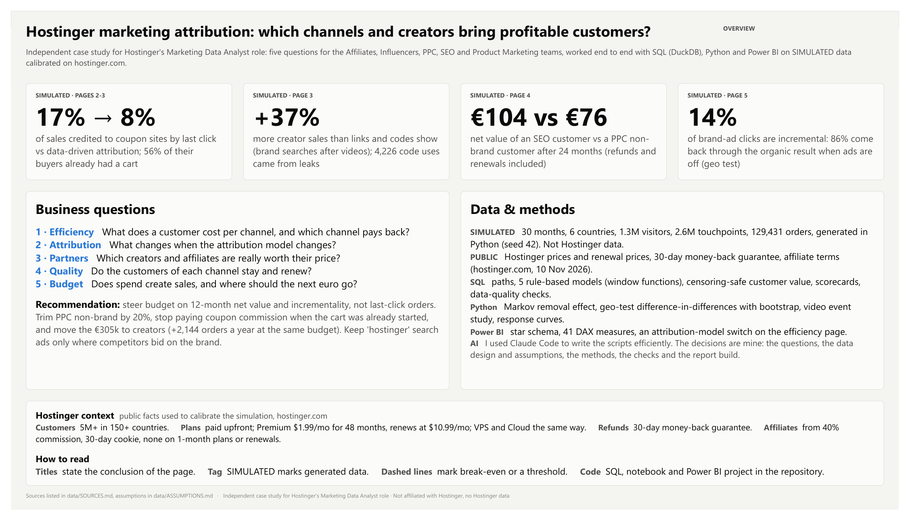
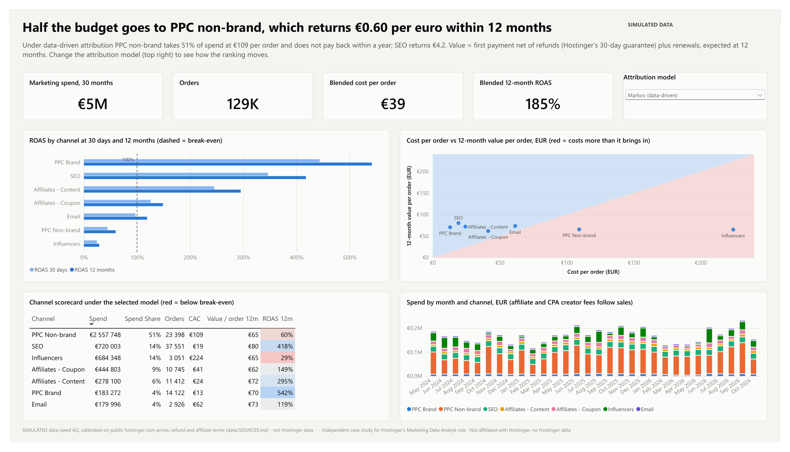
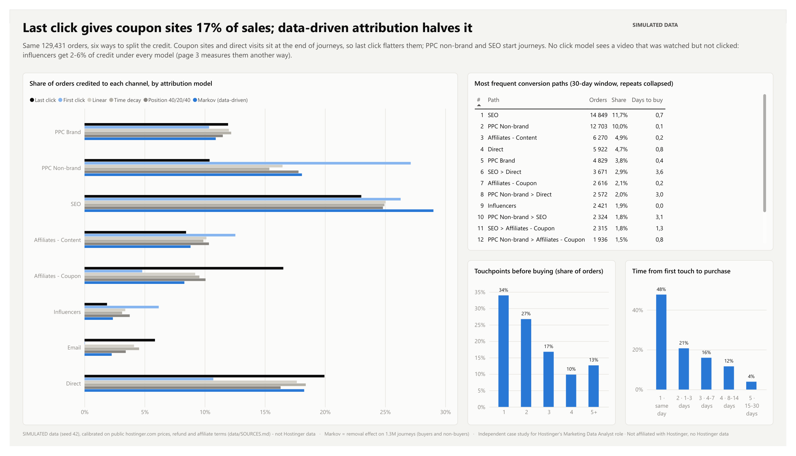
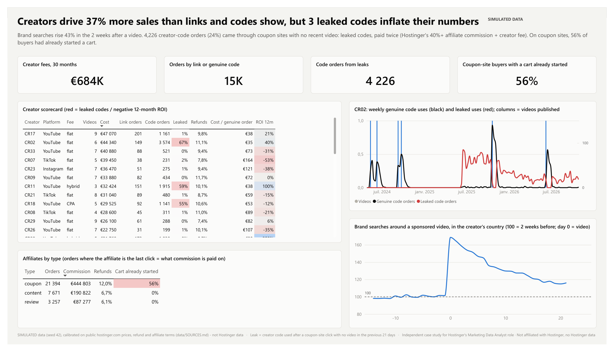
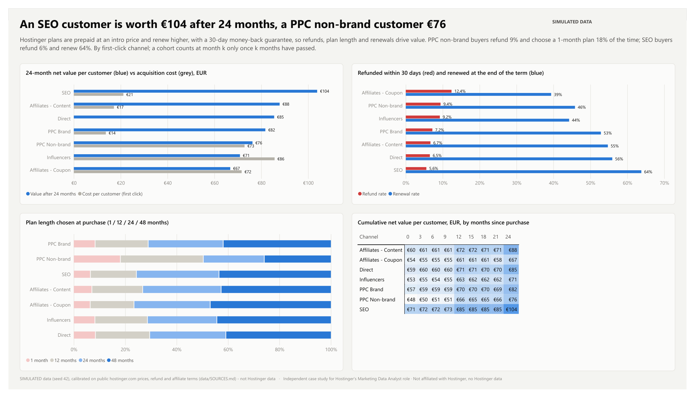
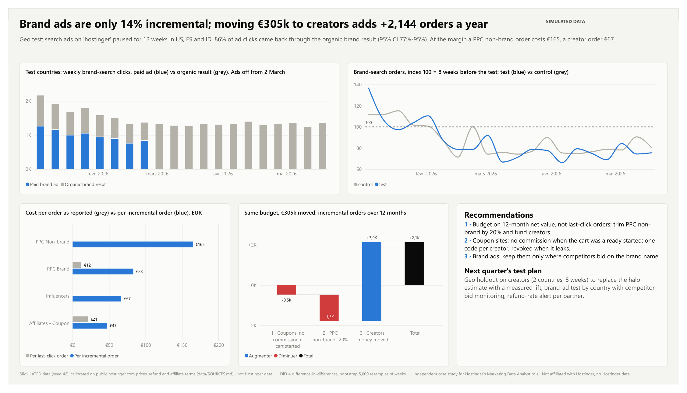

# Hostinger marketing attribution: which channels and creators bring profitable customers?

Independent case study for **Hostinger's Marketing Data Analyst** role · **simulated data** calibrated on Hostinger's public prices and terms.
Not affiliated with Hostinger, no logo, and **no Hostinger data**: customers, orders and marketing spend are **SIMULATED** (seed 42). Every public fact used for calibration is listed with its link in [data/SOURCES.md](data/SOURCES.md).

**Main message:** budget should not be steered on last-click orders or sign-ups, but on the **net value of customers** (after refunds and renewals) and on **incrementality**. The study builds that process from scratch for the teams the role works with (Affiliates, Influencers, PPC, SEO, Product Marketing): tracking checks, attribution, customer value, partner scorecards, a geo test and a budget reallocation.

## Hostinger context (public, hostinger.com, read 10 Nov 2026)
| Fact | Why it matters for attribution | Source |
|---|---|---|
| 5M+ customers in 150+ countries; founded in 2004 in Kaunas, Lithuania | many markets, so geo tests are possible | [About](https://www.hostinger.com/about) |
| Plans paid upfront; Premium $1.99/mo for 48 months, renews at $10.99/mo (Cloud $7.99 → $25.99, VPS KVM 1 $6.49 → $11.99) | first payment ≠ customer value: renewals at a higher price decide profitability | [Pricing](https://www.hostinger.com/pricing), [Cloud](https://www.hostinger.com/cloud-hosting), [VPS](https://www.hostinger.com/vps-hosting) |
| 30-day money-back guarantee | a sale is only final after 30 days; refunds differ by channel | [Refund policy](https://www.hostinger.com/legal/refund-policy) |
| Affiliate commission from 40%, 30-day cookie, none on 1-month plans or renewals, removed if refunded within 45 days; affiliates must not use other affiliates' coupon codes | affiliates are paid on last click, and codes can leak to coupon sites | [Affiliates](https://www.hostinger.com/affiliates), [Agreement](https://www.hostinger.com/legal/affiliate-program-agreement) |

## Questions and answers
| # | Question | Answer (simulated data) |
|---|---|---|
| 1 | What does a customer cost per channel, and which channel pays back? | PPC non-brand takes 51% of spend and returns €0.60 per euro within 12 months under data-driven attribution. SEO, content affiliates and brand search pay back several times. |
| 2 | What changes when the attribution model changes? | Last click gives coupon sites 17% of sales; Markov (data-driven) gives them 8%. PPC non-brand rises from 10% to 18%. No click model sees a video that was watched but not clicked: influencers get 2-6% of credit under every model. |
| 3 | Which creators and affiliates are really worth their price? | Brand searches rise 43% in the two weeks after a video: creators drive at least 37% more sales than their links and codes show. But 3 creator codes leaked to coupon sites: 4,226 orders (24% of creator-code orders) were paid twice. 56% of coupon-site buyers had already started a cart. |
| 4 | Do the customers of each channel stay? | After 24 months an SEO customer is worth €104, a PPC non-brand customer €76. PPC non-brand buyers refund more (9.4% vs 5.6%) and pick more 1-month plans; coupon buyers refund the most (12.4%) and renew the least (39%). |
| 5 | Does spend create sales, and where should the next euro go? | Geo test: with brand ads off, 86% of ad clicks came back through the organic result (incrementality 14%, 95% CI 5-23%). At the margin a PPC non-brand order costs €165 and a creator order €67. Moving €305k from PPC non-brand and coupon commissions to creators adds ~2,100 orders a year at the same budget. |

## The report
Six pages, one question each: overview, channel efficiency, attribution, influencers & affiliates, customer quality, incrementality & budget.
Full report: [docs/HostingerAttribution.pdf](docs/HostingerAttribution.pdf). Built in Power BI.



| | |
|---|---|
|  |  |
|  |  |
|  | |

## How it is built
```
data/clean      simulated tables (Parquet, CSV): touchpoints, orders, refunds, renewals, spend, creators, affiliates, geo test
data/output     SQL and notebook outputs read by Power BI
data/SOURCES.md public facts with links; data/ASSUMPTIONS.md every simulation assumption and plausibility check
sql/            DuckDB queries, standard SQL close to Snowflake / BigQuery
notebooks/      analysis.ipynb: Markov attribution, geo-test DiD, influencer halo, response curves, anomalies
src/            generate_sim.py, run_sql.py, build_tmdl.py (semantic model), build_report_pages.py (report pages)
powerbi/        Power BI project (.pbip: semantic model in TMDL + report in PBIR), theme
docs/           report PDF and screenshots
```

**SQL** (`sql/`), the core of the work:
| File | What it does |
|---|---|
| `00_staging.sql` | de-duplicates tracking events (`LAG`), builds each order's 30-day path (`ROW_NUMBER`, `COUNT() OVER`), first and last click (`FIRST_VALUE`, `LAST_VALUE`) |
| `01_channel_daily.sql` | spend, orders, CAC and 30-day ROAS per day and channel on a date spine (days without spend kept, `NULLIF` against division by zero) |
| `02_conversion_paths.sql` | paths with `STRING_AGG … ORDER BY`, repeats collapsed, path length, time to convert, Markov input (buyers and non-buyers) |
| `03_rule_based_attribution.sql` | last click, first click, linear, time decay (7-day half-life), position 40/20/40, with a check that every order sums to 1 |
| `04_customer_value.sql` | net value per order (paid − refunded + renewals) at 30 days, 12 and 24 months; censoring-safe value curve by channel; payback month |
| `05_creator_scorecard.sql` | creator scorecard (link vs code, leaked codes, refunds, ROI), weekly code use, affiliate scorecard ("cart already started") |
| `06_geo_test.sql` | weekly panel for the difference-in-differences |
| `07_data_quality.sql` | duplicates, orders without touchpoints, missing cost days, spend rows without campaign, spend vs invoices |

**Python** (`notebooks/analysis.ipynb`) only does what SQL does badly: Markov removal effect coded by hand (absorbing-chain formula), difference-in-differences with a paired bootstrap, an event study of brand searches around videos, power-curve fits (`a·spend^b`) and marginal cost per order, simple anomaly rules.

**Power BI**: star schema (facts: Orders, Attribution Credits, Spend; dimensions: Date, Channel, Attribution Model, Country, Creator, Affiliate), 41 DAX measures in display folders. An attribution-model slicer drives every "credited" measure on the channel-efficiency page. Refunds and renewals are folded into the Orders fact at order level, which keeps the model a clean star.

## How AI was used
I used **Claude Code** to write the scripts efficiently, especially in Python, which I am still learning. The decisions are mine: the business questions, the data design and simulation assumptions, the methods, the checks, the Power BI model and report build, and the conclusions. I can explain every page, query and line of code.

## Method notes and limits
- **Simulated data** demonstrates the method, not Hostinger's real channel performance. Every assumption is in `data/ASSUMPTIONS.md`; the simulation has known "true" effects (for example 15% brand-ad incrementality) and the analysis recovers them (14%).
- **Attribution is correlational.** Even the Markov model only redistributes credit across observed clicks: it cannot see a video that was watched but not clicked, and it still over-credits coupon sites that sit right before checkout. Real incrementality needs tests (geo tests, holdouts, conversion lift).
- **Influencer halo** is an estimate from an event study (orders nobody claims, before vs after each video). It is conservative and should be replaced by a creator geo holdout.
- **Customer value** is censoring-safe: a cohort counts at month *k* only once *k* months have passed. Only cohorts from May-Oct 2024 reach 24 months.
- **12-month value** is actual for mature orders and projected for recent ones (paid + average renewals of mature orders with the same product, plan and channel).
- **Response curves** are fitted on monthly spend that varied for planning reasons, not in a randomised way: they show direction and orders of magnitude, not exact marginal costs.

## Reproduce
```bash
git clone https://github.com/albt-france/hostinger-marketing-attribution-analytics.git
cd hostinger-marketing-attribution-analytics
python -m venv .venv
.venv/Scripts/pip install -r requirements.txt          # .venv/bin/pip on macOS / Linux
.venv/Scripts/python src/generate_sim.py               # simulated data, seed 42
.venv/Scripts/python src/run_sql.py                    # SQL outputs -> data/output
.venv/Scripts/jupyter nbconvert --to notebook --execute --inplace notebooks/analysis.ipynb
.venv/Scripts/python src/build_tmdl.py                 # Power BI semantic model (TMDL)
.venv/Scripts/python src/build_report_pages.py         # Power BI report pages (PBIR)
```
Power BI: open `powerbi/HostingerAttribution.pbip`, set the `DataFolder` parameter (Transform data → Edit parameters) to your local `data\` folder, then refresh. The large generated files are not in the repository: run the steps above first.

---
Independent case study for Hostinger's Marketing Data Analyst role, not affiliated with Hostinger.
